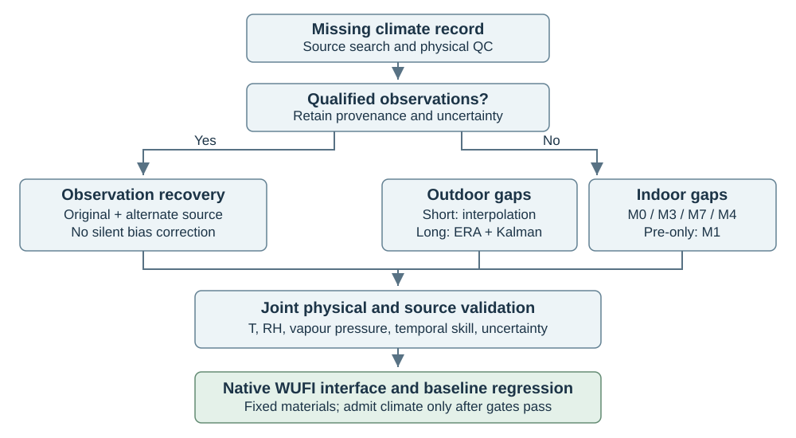

# Climate gap recovery and native admission — methods and validation

**Methods report v0.8.0 — 25 November 2026.** This report describes the approved research architecture and decision criteria, not a released weather dataset or production WUFI climate. Experimental measurements, source-sensitive numerical results and unpublished charts remain in the authorized private research workspace.

*Figure 1. Proposed method-selection and climate-admission architecture. Schematic only; not experimental data or a performance plot.*

## 1. Why source recovery precedes inference

A missing record from one acquisition system is not necessarily an unobserved physical state. Search for separately acquired measurements, qualify their instrumentation and clocks, and preserve provenance before estimating missing values. Source agreement does not prove spatial representativeness or installed uncertainty. The latest research stage has constructed a complete provisional hourly interior/exterior temperature and humidity record from available monitoring sources. This is aggregate-level recovery, not physical boundary admission.

The canonical intermediate representation stores UTC timestamps, aggregation support, units, valid-sample counts, measurement-source identities, QC flags, and source-specific observations. Maintain alternative sources separately; do not silently average or correct them. Preserve genuinely observed values when feasible, and retain original records even when flagged or replaced in derived candidates.

## 2. Reusable reconstruction architecture

| Available information | Exterior | Interior |
|---|---|---|
| Qualified measurements | Source recovery | Source recovery |
| Short, bracketed gap | Linear/PCHIP baseline | M0 interpolation baseline |
| Longer retrospective gap | Actual-date ERA5-Land plus bounded local Kalman/RTS correction | M3 state-space smoothing; M7 moisture extension; M4 comparator |
| One-sided indoor information | Clearly distinguish historical weather forcing from forecast inputs | M1 bounded effective RC; future causal M3 filter-only arm |
| Auxiliary wall observations | Not required for ordinary weather reconstruction | Conditional wall-assisted M3/M6; reserved wall channels for validation |
| Weak source evidence | Direct reanalysis and partial-correction sensitivity | Explicit scenario/uncertainty branches, not invented observations |

Selection should depend on duration, source availability, physical validity and out-of-window transfer, not model complexity alone. Direct reanalysis, full correction and half correction are distinct sensitivity candidates; half correction is not a calibrated confidence interval.

## 3. Exterior methods

Use a locally fitted harmonic correction of actual-date ERA5-Land temperature and bounded humidity coordinates. Fit residual dynamics on nonhidden measured periods, with separate observation support and explicit residual sign (model minus observation). The state-space form is

$$
r_{k+1}=A_k r_k+B_k u_k+\eta_k,\qquad
y_k=b_k+H_k r_k+\epsilon_k. \tag{1}
$$

Here the baseline includes the known historical reanalysis forcing and locally fitted mean correction. Kalman filtering estimates the forward state; Rauch–Tung–Striebel smoothing uses later observations only when the retrospective information set permits it. Apply physical constraints through transformed state coordinates rather than hiding violations by diagnostic clipping.

$$
\mathrm{RH}_k=\frac{1}{1+\exp(-z_k)},\qquad
p_{v,k}=\mathrm{RH}_k\,p_{\mathrm{sat}}(T_k). \tag{2}
$$

The saturation convention must be consistent with the source sensor and native solver interpretation, especially below freezing.

Controlled DMDc and delay/lifted variants are retained as secondary research comparators. The tested residual autoregressive DMDc-style models use known ERA controls, forward/reverse fits and boundary blending. They are not independently certified Koopman modal models. Their modest temperature improvements in selected shorter masks did not establish robust long-gap humidity or wet-event superiority.

## 4. Indoor model ladder

| Family | Method | Current methodological disposition |
|---|---|---|
| M0 | Weather regression, short interpolation, endpoint taper | Retain short-gap baseline |
| M1 | Bounded one-pole thermal/vapour dynamics | Leading tested pre-gap-only historical comparator, not universally stable |
| M2 | Two-pole thermal surrogate | Additional complexity not justified |
| M3 | Effective RC transition, Kalman filter and RTS smoother | Preferred retrospective reference; future separate causal branch |
| M4 | Weather-exogenous SARIMAX | Complementary statistical comparator |
| M5 | Controlled multivariate DMDc | Stability and long-run drift concerns |
| M6 | Dynamic wall and latent effective heat state | Conditional auxiliary method, cross-regime transfer pending |
| M7 | Vapour concentration with effective reservoir and latent source | Promising simplified moisture extension; storage not identified |
| M8 | Sparse-switch effective operating source | Deferred after numerical/physical long-gap failures |
| M9 (working label) | Measurement-driven room thermal/moisture ROM | Exploratory; thermal identification failed, simplified moisture balance merits testing |

The existing M3 already uses Kalman filtering **and** RTS smoothing. A new causal variant must suppress backward smoothing and all unavailable future observations. For comparison, fix the training interval, forcing availability, initial-state handling and evaluation windows. A known future historical weather trajectory is not a real-time forecast.

For an effective indoor state,

$$
x_{k+1}=A_k x_k+B_k u_k+\eta_k,\qquad
y_k=H_k x_k+\epsilon_k. \tag{3}
$$

A missing measurement suppresses the corresponding observation update. Optional wall measurements change the information set; the same channels cannot then be used as independent calibration targets without a separate holdout design.

A useful simple moisture model is

$$
w_{k+1}=a_w w_k+(1-a_w)w_{\mathrm{out},k}+d_w. \tag{4}
$$

This is an effective humidity-ratio relation, not measured ventilation or a material sorption curve. Controller command data are not evidence of delivered heat or moisture. A constant thermal input is confounded with a free intercept; identification requires independent physical measurements and adequate excitation.

## 5. Validation contract

Use only genuinely observed periods as artificial-gap truth. Record mask identity, season, duration, overlapping masks, available predictors and reference sensor uncertainty. Retain negative results and independently test poisoning of hidden labels. Compare like information sets. Report the number of folds and independent seasonal coverage, not only aggregate hours.

Metrics must include T, RH, and vapour pressure separately, with residual bias, MAE, RMSE, quantile error, saturation and freezing-event detection, daily amplitude/phase, lagged increments, and multiscale variability where the window supports them. Derived vapour pressure is not an independent third measurement. Retain invalid or nonconverged results explicitly. Distinguish conditional sensitivity, block resampling intervals, and calibrated instrument/model uncertainty. Do not label a nominal state-space interval as calibrated if long-gap coverage fails.

The original outdoor and indoor blocked-mask benchmarks are preserved. Newly recovered data were used for separate historical-gap scoring without refitting the frozen model families. The completed private study supports bounded ERA–Kalman for long outdoor gaps and M3/M1/M7/M4 as the indoor reference family, while rejecting universal rankings across differing gap lengths and information sets. The additional measurement-driven model remains exploratory rather than a new blind holdout.

## 6. Native WUFI6 admission ladder

| Gate | Acceptance requirement | Current status |
|---|---|---|
| N0 | Canonical hourly sources, provenance and aggregate QC | Research recovery complete |
| N1 | Physical instrumentation, exposure, geometry, pressure and timing qualification | Partial; pending |
| N2 | Separate versioned interior/exterior candidates and exact numerical readback | T/RH-only research patches structurally verified; full weather admission pending |
| N3 | Native climate interpretation on disposable copies | Not run |
| N4 | Reproduce archived native baseline outputs | Not run |
| N5 | Climate-only sensitivity, fixed material properties | Not run |
| N6 | Freeze admitted climate and uncertainty for separate inversion | Not run |

For N1, certify indoor boundary representativeness, outdoor shielding/height/exposure, coordinates/elevation/facade orientation, radiation components, rain versus snow and driving rain, pressure field convention and clock/aggregation semantics. Surface pressure must not be silently copied into a sea-level-pressure field. De-accumulated reanalysis radiation and precipitation must not be de-accumulated again. Derived solar components and liquid-equivalent precipitation are not measured facade exposure.

For N2, distinguish the physical study horizon from artificial file padding and separately label every forcing variable. The new T/RH replacement fixtures retain legacy non-T/RH weather fields and are not admitted full-weather WACs. Keep original climate and project files immutable.

For N3, run only isolated copies with the pinned solver version and a distinguishable synthetic hourly fixture to verify time indexing, units, field meaning and readback. For N4, predeclare tolerances and compare archived baseline outputs on matched time/spatial axes, geometry, monitor indices, initial conditions and material identities. A native import success is not a numerical baseline pass.

For N5, compare frozen climate C0, interior-only C1, exterior-only C2, and combined C3, then reconstruction sensitivity alternatives C4/C5. Evaluate wall heat/moisture state with unchanged material parameters. The two-factor interaction is

$$
\Delta Y_{\mathrm{int}}=Y_{C3}-Y_{C2}-Y_{C1}+Y_{C0}. \tag{5}
$$

Evaluate moisture storage, wetting/drying, condensation and mould diagnostics only with appropriate physical definitions and validated outputs. N6 is a separate admission decision, not automatic material optimization.

## 7. Reproducibility and distribution

The detailed private report includes source-specific hourly reconstruction, original mask scores, actual-gap comparisons, residual and multiscale analysis, sensor discrepancies, energy/moisture diagnostics, negative results, figure sources, scripts and candidate WAC QA. It is not published here because experimental-data rights and code licensing are distinct.

This public report is a methods and acceptance contract; it does not claim implementation of a production selector, new causal M3 branch, fully qualified climate WAC, native regression or material optimizer. Existing public Python modules remain candidate integration points. Reviewed PRs and test results are distinct from live site deployment.

See [Campaign 2 overview](campaign2.md), [climate conventions](climate.md), [validation](validation.md), and [data provenance](data-provenance.md).
